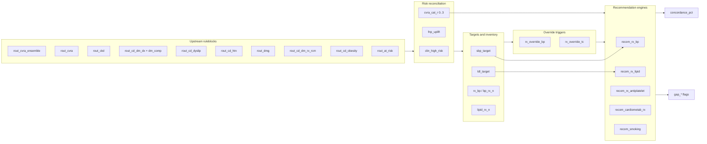
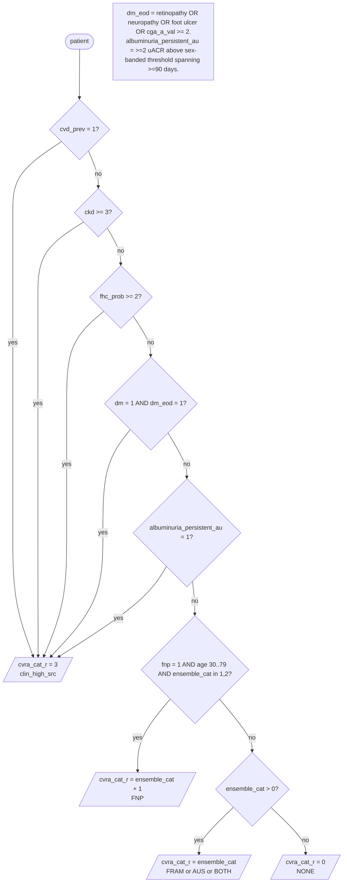
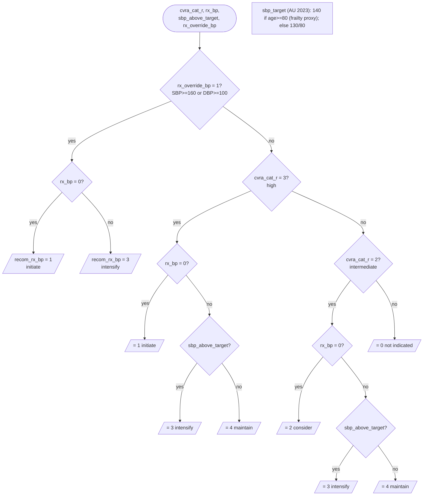
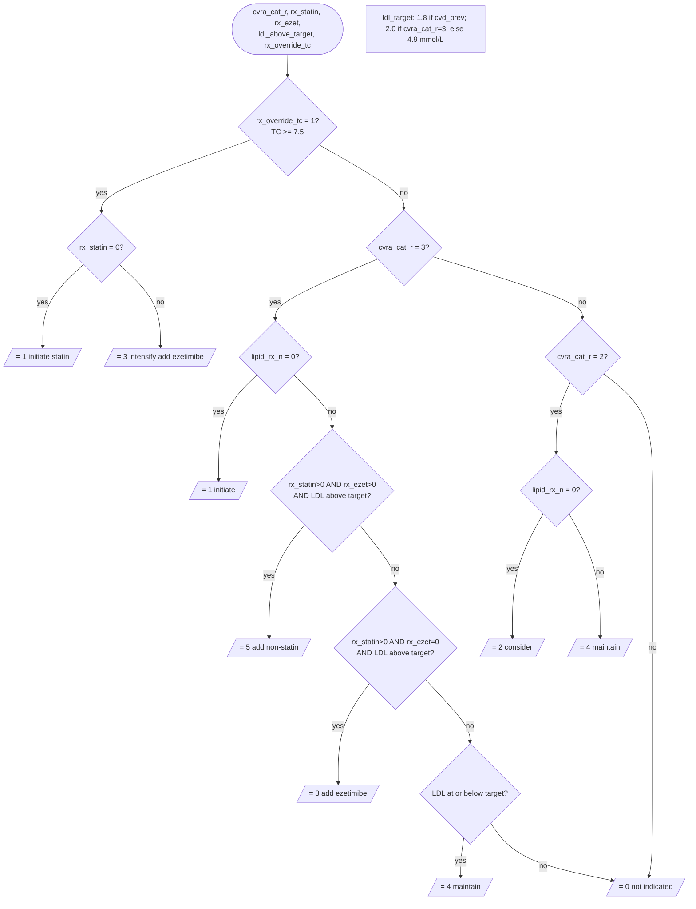
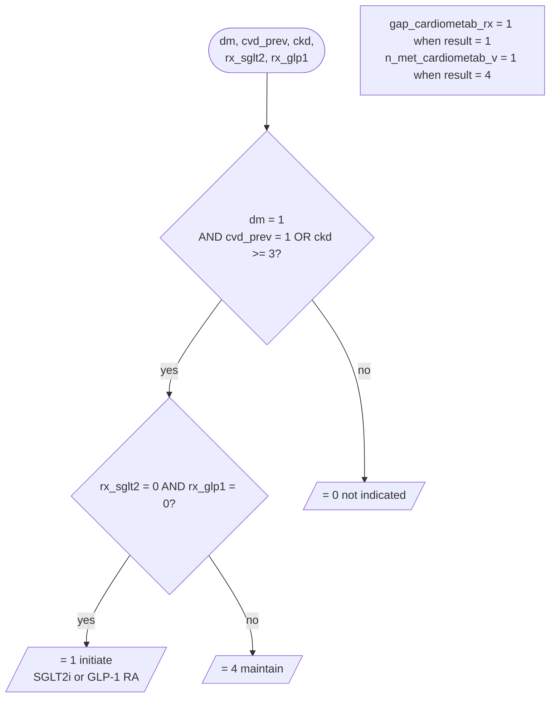

# cd_cvra_recom_v2 — flow diagrams

Companion to [`cd_cvra_recom_v2.prb`](./cd_cvra_recom_v2.prb). Decision flows for each recommendation domain, sliced for readability. Diagrams reflect rule logic as of 2026-05-19; re-verify against the `.prb` if it has changed since.

For rationale, guideline citations (AU 2023, ESC/EAS 2025, AHA/ACC 2025 BP, KDIGO 2024) and v1→v2 changes, see the header comment of the `.prb`.

---

## 1. Overview — how bindings feed the recommendation engines



---

## 2. Risk reconciliation → `cvra_cat_r`

Clinical overrides short-circuit the ensemble category. First match wins.



---

## 3. BP pharmacotherapy → `recom_rx_bp`

Codes: `1` initiate, `2` consider, `3` intensify, `4` maintain, `0` not indicated.



---

## 4. Lipid pharmacotherapy → `recom_rx_lipid` (extended ladder)

Codes: `1` initiate statin, `2` consider statin, `3` intensify (add ezetimibe), `4` maintain, `5` add non-statin intensifier (bempedoic acid / PCSK9i / inclisiran), `0` not indicated.



---

## 5. SGLT2i / GLP-1 cardio-renal → `recom_cardiometab_rx` (new in v2)

Codes: `1` initiate, `4` maintain, `0` not indicated.



---

## 6. Antiplatelet, smoking, and concordance roll-up

Smaller branches grouped — each is shallow on its own.

```mermaid
flowchart TD
    subgraph AP[Antiplatelet — secondary prevention]
        AP_Q{cvd_prev = 1?}
        AP_NONE{antipl = 0 AND anticoag = 0?}
        AP_I[/recom_rx_antiplatelet = 1<br/>+ gap_antiplatelet/]
        AP_M[/recom_rx_antiplatelet = 4/]
        AP_Z[/= 0/]
        AP_Q -- yes --> AP_NONE
        AP_Q -- no  --> AP_Z
        AP_NONE -- yes --> AP_I
        AP_NONE -- no  --> AP_M
    end

    subgraph SMK[Smoking]
        SMK_Q{smoke0 >= 29?<br/>current}
        SMK_RX{rx_cessation present?}
        SMK_I[/= 1 offer cessation Rx<br/>+ gap_smoking_rx/]
        SMK_M[/= 2 maintain Rx/]
        SMK_EX{smoke0 = 20?<br/>ex-smoker}
        SMK_S[/= 3 sustain/]
        SMK_Z[/= 0/]
        SMK_Q -- yes --> SMK_RX
        SMK_RX -- no  --> SMK_I
        SMK_RX -- yes --> SMK_M
        SMK_Q -- no --> SMK_EX
        SMK_EX -- yes --> SMK_S
        SMK_EX -- no  --> SMK_Z
    end

    subgraph CONC[Concordance score]
        APP["n_applicable = sum of applicable domains<br/>(bp, lipid, antipl, smoking, cardiometab)"]
        MET["n_met = sum of domains at code 4 or smoking=2"]
        PCT[/concordance_pct =<br/>round(n_met / n_applicable * 100)/]
        APP --> PCT
        MET --> PCT
    end
```

---

## Maintenance

- Diagrams are hand-maintained. When a conditional in `.prb` changes, update the matching slice here.
- If drift becomes a problem across multiple ruleblocks, consider an auto-generator that walks the compiler AST and emits Mermaid per output variable.
